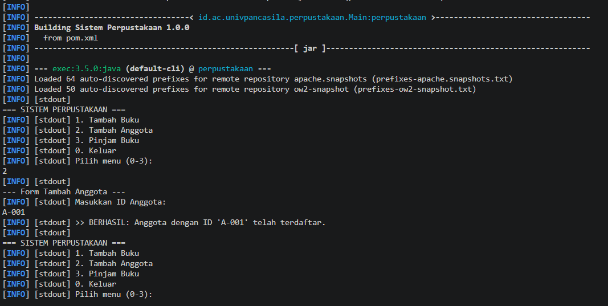
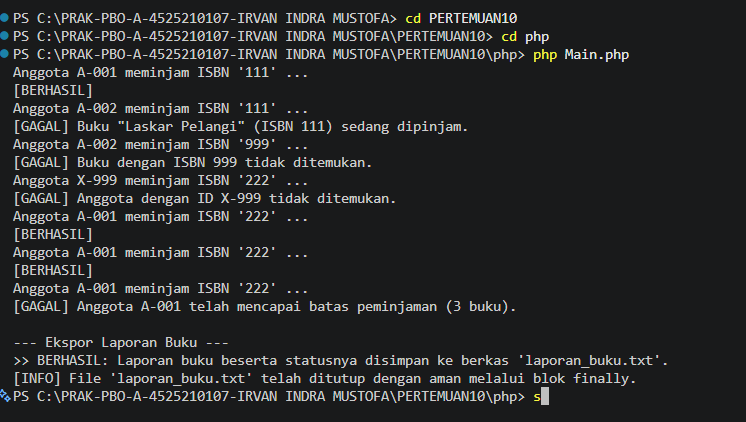

# LAPORAN PRAKTIKUM PEMROGRAMAN BERBASIS OBJEK

| Informasi Praktikan | Keterangan |
| :--- | :--- |
| **Nama** | Irvan Indra Mustofa |
| **NPM** | 4525210107 |
| **Kelas** | A |
| **Mata Kuliah** | Pemrograman Berbasis Objek (PBO) |
| **Pertemuan** | 10 - Exception Handling dan Pemrograman Defensif |
| **Tanggal** | Kamis 5 November 2026 |

---

## 1. Implementasi Java

### 1.1. File: `Main.java`

**Penjelasan Kode:**
> Main.Java Menampilkan menu interaktif (1. Tambah Buku, 2. Tambah Anggota, 3. Pinjam Buku, 0. Keluar) dalam perulangan while dan  aksi dengan switch. Setiap aksi diteruskan ke PerpustakaanService. Pilihan di luar 0-3 ditolak dengan peringatan. Setelah pengguna keluar, method eksporLaporan() menulis daftar buku ISBN, judul, stok, status Tersedia/Tidak Tersedia.

**Kode Program:**

```java
package id.ac.univpancasila.perpustakaan;

import java.io.FileWriter;
import java.io.IOException;
import java.io.PrintWriter;
import java.util.Map;
import java.util.Scanner;
import  id.ac.univpancasila.perpustakaan.service.*;


public class Main {
    public static void main(String[] args) {
        LibraryService libService = new LibraryService();
        Scanner scanner = new Scanner(System.in);
        boolean berjalan = true;

        while (berjalan) {
            System.out.println("\n=== SISTEM PERPUSTAKAAN ===");
            System.out.println("1. Tambah Buku");
            System.out.println("2. Tambah Anggota");
            System.out.println("3. Pinjam Buku");
            System.out.println("0. Keluar");
            System.out.println("Pilih menu (0-3): ");

            String pilihan = scanner.nextLine().trim();

            switch (pilihan) {
                case "1":
                    PerpustakaanService.tambahBuku(libService, scanner);
                    break;
                case "2":
                    PerpustakaanService.tambahAnggota(libService, scanner);
                    break;
                case "3":
                    PerpustakaanService.pinjamBuku(libService, scanner);
                    break;
                case "0":
                    System.out.println("Terima kasih telah menggunakan sistem perpustakaan.");
                    berjalan = false;
                    break;
                default:
                    System.out.println("[Peringatan] Pilihan menu tidak valid! Silakan masukkan angka 0 - 3.");
            }
        }
        
        System.out.println("\nMengekspor daftar transaksi ke berkas...");
        eksporLaporan(libService);

        scanner.close();
    }

    private static void eksporLaporan(LibraryService service) {
        System.out.println("\n--- Ekspor Laporan Buku ---");
        String namaFile = "laporan_buku.txt";

        try (PrintWriter writer = new PrintWriter(new FileWriter(namaFile))) {
            writer.println("==========================================================================");
            writer.println("                    LAPORAN DAFTAR BUKU PERPUSTAKAAN                      ");
            writer.println("==========================================================================");
            writer.printf("%-12s | %-35s | %-8s | %-15s%n", "ISBN", "JUDUL BUKU", "STOK", "STATUS");
            writer.println("--------------------------------------------------------------------------");

            Map<String, String> daftarJudul = service.getSemuaJudul();

            if (daftarJudul.isEmpty()) {
                writer.println("Belum ada data buku dalam sistem.");
            } else {
                for (Map.Entry<String, String> entry : daftarJudul.entrySet()) {
                    String isbn = entry.getKey();
                    String judul = entry.getValue();
                    int stokSisa = service.sisaEksemplar(isbn);

                    String status = (stokSisa > 0) ? "Tersedia" : "Tidak Tersedia";

                    writer.printf("%-12s | %-35s | %-8d | %-15s%n", isbn, judul, stokSisa, status);
                }
            }

            writer.println("==========================================================================");
            System.out.println(">> BERHASIL: Laporan buku beserta statusnya disimpan ke berkas '" + namaFile + "'.");

        } catch (IOException e) {
            System.out.println("[ERROR FILE] Gagal menulis laporan ke berkas: " + e.getMessage());
        }
    }
}
```


### 1.2. File: `AnggotaTidakDitemukanException.java`

**Penjelasan Kode:**
> Exception domain yang dilempar saat ID anggota belum terdaftar. Turunan PerpustakaanException dan membawa data idAnggota atribut private final beserta getter getIdAnggota(), sehingga pemanggil bisa mengambil ID penyebab error.

**Kode Program:**

```java
package id.ac.univpancasila.perpustakaan.exception;

/**
 * TODO: lengkapi mengikuti pola BukuTidakDitemukanException.
 *       Exception ini membawa idAnggota.
 */
public class AnggotaTidakDitemukanException extends PerpustakaanException {
    private final String idAnggota;
    public AnggotaTidakDitemukanException(String idAnggota) {
        super("Anggota dengan ID " + idAnggota + " tidak ditemukan");
        this.idAnggota = idAnggota;
    }

    public String getIdAnggota(){
        return this.idAnggota;
    }
}
```

### 1.3. File: `BatasPinjamTerlampauiException.java`

**Penjelasan Kode:**
>Exception yang dilempar saat anggota sudah mencapai batas maksimum peminjaman. Membawa dua data, yaitu idAnggota dan batas, lengkap dengan getter-nya, sehingga pemanggil dapat menampilkan batas tanpa harus mengetahui aturannya sendiri.

**Kode Program:**

```java
package id.ac.univpancasila.perpustakaan.exception;

/**
 * TODO: exception ini membawa idAnggota dan batas maksimum.
 *       Menyertakan batas di dalam exception memudahkan pemanggil
 *       menyusun pesan tanpa harus mengetahui aturannya sendiri.
 */
public class BatasPinjamTerlampauiException extends PerpustakaanException {
    private  final String idAnggota;
    private final int batas;

    public BatasPinjamTerlampauiException(String idAnggota, int batas) {
        super("Anggota dengan ID " + idAnggota + " telah mencapai batas maksimum peminjaman");
        this.idAnggota = idAnggota;
        this.batas = batas;
    }

    public String getIdAnggota(){
        return this.idAnggota;
    }

    public int getBatas(){
        return this.batas;
    }
}
```

### 1.4. File: `BukuSedangDipinjamException.java`

**Penjelasan Kode:**
> Exception yang dilempar saat stok buku habis (semua eksemplar sedang dipinjam). Membawa isbn untuk diolah sistem dan judul agar pesan ke pengguna lebih bermakna, masing-masing dengan getter.

**Kode Program:**

```java
package id.ac.univpancasila.perpustakaan.exception;

/**
 * TODO: exception ini membawa DUA data — isbn dan judul.
 *       Judul disertakan agar pesan untuk pengguna lebih berarti;
 *       isbn disertakan agar sistem dapat mengolahnya.
 */
public class BukuSedangDipinjamException extends PerpustakaanException {
    private final String isbn;
    private  final String judul;

    public BukuSedangDipinjamException(String isbn, String judul) {
        super("Buku " + judul + " dengan ISBN  " + isbn + " sedang dipinjam");
        this.isbn = isbn;
        this.judul = judul;
    }

    public String getIsbn(){
        return this.isbn;
    }

    public String getJudul(){
        return this.judul;
    }
}
```

### 1.5. File: `BukuTidakDitemukanException.java`

**Penjelasan Kode:**
> Exception yang dilempar saat ISBN tidak ada di katalog. Membawa data isbn (bukan sekadar teks pesan) dan menyediakan getIsbn(), sehingga pemanggil bisa mengambil kembali penyebab error secara terstruktur.

**Kode Program:**

```java
package id.ac.univpancasila.perpustakaan.exception;

/**
 * EXCEPTION YANG MEMBAWA DATA — bukan sekadar teks.
 *
 * Perhatikan atribut isbn di bawah. Itulah yang membedakan exception ini
 * dari exception biasa: pemanggil bisa MENGAMBIL data penyebabnya kembali,
 * bukan harus mengurai kalimat pesan.
 *
 * Pada sesi 13 dan 14, data inilah yang menjadi isi badan respons HTTP 404.
 */
public class BukuTidakDitemukanException extends PerpustakaanException {

    // TODO 1: deklarasikan atribut privat final untuk isbn.
    private final String isbn;

    public BukuTidakDitemukanException(String isbn) {
        // TODO 2: panggil super(...) dengan pesan yang menyebut ISBN-nya,
        //         misalnya: "Buku dengan ISBN 978-1 tidak ditemukan"
        super("Buku dengan ISBN " + isbn + " tidak ditemukan");

        // TODO 3: simpan isbn ke atribut.
        this.isbn = isbn;
    }

    // TODO 4: sediakan getter getIsbn().
    public String getIsbn(){
        return this.isbn;
    }
}
```

### 1.6. File: `PerpustakaanException.java`

**Penjelasan Kode:**
> Kelas induk abstract untuk seluruh exception domain perpustakaan, diturunkan dari RuntimeException (unchecked) karena kegagalannya  permintaan yang tidak sah, bukan kondisi luar yang wajar. Dengan induk bersama, semua kegagalan domain bisa ditangkap sekaligus lewat satu blok catch tanpa  kesalahan pemrograman lain.

**Kode Program:**

```java
package id.ac.univpancasila.perpustakaan.exception;

/**
 * Sesi 10 — induk seluruh exception domain perpustakaan.
 *
 * Manfaat punya induk bersama: pemanggil bisa menangkap SELURUH kegagalan
 * domain sekaligus dengan satu blok catch, tanpa ikut menelan kesalahan
 * pemrograman yang lain.
 *
 * TODO 1: putuskan — turunkan dari RuntimeException (unchecked) atau dari
 *         Exception (checked)? Tuliskan alasannya di skenario-uji.md.
 *         Petunjuk: kalau kegagalannya menandakan permintaan yang tidak sah
 *         dan bukan keadaan luar yang wajar, unchecked biasanya lebih tepat.
 */
public abstract class PerpustakaanException extends RuntimeException {

    protected PerpustakaanException(String pesan) {
        super(pesan);
    }

    protected PerpustakaanException(String pesan, Throwable penyebab) {
        super(pesan, penyebab);
    }
}
```

### 1.7. File: `LibraryService.java`

**Penjelasan Kode:**
> HashMap: stok, judul, dan pinjaman. Method pinjam() memakai guard clause: tiap syarat (anggota ada, buku ada, stok tersedia, batas pinjam belum tercapai) diperiksa berurutan dan langsung throw exception yang sesuai bila gagal. Alur utama (kurangi stok, tambah pinjaman) berada di akhir tanpa percabangan bersarang, dan pemanggil tahu alasan kegagalannya. Method pendukung: tambahBuku, daftarkanAnggota, sisaEksemplar, judulDari, getSemuaJudul.

**Kode Program:**

```java
package id.ac.univpancasila.perpustakaan.service;
/**
 * Sesi 10 Langkah 2 — BAHAN REFACTORING.
 *
 * Method pinjam() di bawah bersarang EMPAT tingkat. Bacalah, lalu rasakan
 * sendiri betapa sulitnya mengikuti alurnya.
 *
 * Tugas Anda: refaktor menjadi guard clause, simpan sebagai LibraryService.java.
 * JANGAN hapus berkas ini — keduanya diperlukan saat demo.
 *
 * Pertanyaan pemandu:
 *   1. Di mana letak logika utamanya? Berapa tingkat menjorok ke dalam?
 *   2. Apa yang terjadi kalau salah satu kondisi tidak terpenuhi?
 *      Apakah pemanggil bisa tahu ALASANNYA?
 *   3. Bagaimana Anda menambahkan satu aturan baru di tengah-tengah ini?
 */
import java.util.HashMap;
import java.util.Map;

import id.ac.univpancasila.perpustakaan.exception.AnggotaTidakDitemukanException;
import id.ac.univpancasila.perpustakaan.exception.BatasPinjamTerlampauiException;
import id.ac.univpancasila.perpustakaan.exception.BukuSedangDipinjamException;
import id.ac.univpancasila.perpustakaan.exception.BukuTidakDitemukanException;

public class LibraryService {

    public static final int BATAS_PINJAM = 3;

    private final Map<String, Integer> stok = new HashMap<>();
    private final Map<String, String> judul = new HashMap<>();
    private final Map<String, Integer> pinjaman = new HashMap<>();

    public void tambahBuku(String isbn, String judulBuku, int eksemplar) {
        stok.merge(isbn, eksemplar, Integer::sum);
        judul.put(isbn, judulBuku);
    }

    public void daftarkanAnggota(String idAnggota) {
        pinjaman.putIfAbsent(idAnggota, 0);
    }

    /** INILAH yang harus Anda refaktor. */
    public boolean pinjam(String idAnggota, String isbn) {
        if (!pinjaman.containsKey(idAnggota)) {
            throw new AnggotaTidakDitemukanException(idAnggota);
        }

        if (!stok.containsKey(isbn)){
            throw new BukuTidakDitemukanException(isbn);
        }

        if (stok.get(isbn) <= 0){
            throw new BukuSedangDipinjamException(isbn, judul.get(isbn));
        }

        if (pinjaman.get(idAnggota) >= BATAS_PINJAM){
            throw new BatasPinjamTerlampauiException(idAnggota, BATAS_PINJAM);
        }

        stok.merge(isbn, -1, Integer::sum);
        pinjaman.merge(idAnggota, 1, Integer::sum);
        return true;
    }

    public int sisaEksemplar(String isbn) {
        return stok.getOrDefault(isbn, 0);
    }

    public String judulDari(String isbn) {
        return judul.get(isbn);
    }

    public Map<String, String> getSemuaJudul() {
        return this.judul;
    }
}
```

### 1.8. File: `LibraryServiceKotor.java`

**Penjelasan Kode:**
> Method pinjam() memakai if bersarang empat tingkat dan hanya mengembalikan true/false, sehingga pemanggil tidak tahu penyebab peminjaman gagal. Berkas ini dipertahankan sebagai pembanding dengan LibraryService.

**Kode Program:**

```java
package id.ac.univpancasila.perpustakaan.service;
/**
 * Sesi 10 Langkah 2 — BAHAN REFACTORING.
 *
 * Method pinjam() di bawah bersarang EMPAT tingkat. Bacalah, lalu rasakan
 * sendiri betapa sulitnya mengikuti alurnya.
 *
 * Tugas Anda: refaktor menjadi guard clause, simpan sebagai LibraryService.java.
 * JANGAN hapus berkas ini — keduanya diperlukan saat demo.
 *
 * Pertanyaan pemandu:
 *   1. Di mana letak logika utamanya? Berapa tingkat menjorok ke dalam?
 *   2. Apa yang terjadi kalau salah satu kondisi tidak terpenuhi?
 *      Apakah pemanggil bisa tahu ALASANNYA?
 *   3. Bagaimana Anda menambahkan satu aturan baru di tengah-tengah ini?
 */
import java.util.HashMap;
import java.util.Map;

public class LibraryServiceKotor {

    public static final int BATAS_PINJAM = 3;

    private final Map<String, Integer> stok = new HashMap<>();
    private final Map<String, String> judul = new HashMap<>();
    private final Map<String, Integer> pinjaman = new HashMap<>();

    public void tambahBuku(String isbn, String judulBuku, int eksemplar) {
        stok.merge(isbn, eksemplar, Integer::sum);
        judul.put(isbn, judulBuku);
    }

    public void daftarkanAnggota(String idAnggota) {
        pinjaman.putIfAbsent(idAnggota, 0);
    }

    /** INILAH yang harus Anda refaktor. */
    public boolean pinjam(String idAnggota, String isbn) {
        if (pinjaman.containsKey(idAnggota)) {
            if (stok.containsKey(isbn)) {
                if (stok.get(isbn) > 0) {
                    if (pinjaman.get(idAnggota) < BATAS_PINJAM) {
                        stok.merge(isbn, -1, Integer::sum);
                        pinjaman.merge(idAnggota, 1, Integer::sum);
                        return true;
                    } else {
                        return false;   // kenapa gagal? pemanggil tidak tahu
                    }
                } else {
                    return false;       // kenapa gagal? pemanggil tidak tahu
                }
            } else {
                return false;           // kenapa gagal? pemanggil tidak tahu
            }
        } else {
            return false;               // kenapa gagal? pemanggil tidak tahu
        }
    }

    public int sisaEksemplar(String isbn) {
        return stok.getOrDefault(isbn, 0);
    }

    public String judulDari(String isbn) {
        return judul.get(isbn);
    }
}
```

### 1.9. File: `PerpustakaanService.java`

**Penjelasan Kode:**
> Kelas penghubung antara input pengguna dan LibraryService, berisi tiga method statis. tambahAnggota memvalidasi ID tidak boleh kosong. tambahBuku memvalidasi ISBN dan jumlah eksemplar (harus angka dan lebih dari 0, NumberFormatException ditangkap). pinjamBuku berjalan dalam perulangan sampai pengguna mengetik exit; exception domain ditangkap lewat PerpustakaanException, lalu instanceof dipakai untuk menampilkan detail spesifik (ISBN, ID anggota, judul, atau batas). Exception umum ditangkap sebagai error sistem.

**Kode Program:**

```java
package id.ac.univpancasila.perpustakaan.service;


import java.util.Scanner;

import id.ac.univpancasila.perpustakaan.exception.AnggotaTidakDitemukanException;
import id.ac.univpancasila.perpustakaan.exception.BatasPinjamTerlampauiException;
import id.ac.univpancasila.perpustakaan.exception.BukuSedangDipinjamException;
import id.ac.univpancasila.perpustakaan.exception.BukuTidakDitemukanException;
import id.ac.univpancasila.perpustakaan.exception.PerpustakaanException;


public class PerpustakaanService {
    public static void tambahAnggota(LibraryService libService, Scanner scanner) {
        System.out.println("\n--- Form Tambah Anggota ---");
        System.out.println("Masukkan ID Anggota: ");
        String idAnggota = scanner.nextLine().trim();


        if (idAnggota.isEmpty()) {
            System.out.println("[Gagal] ID Anggota tidak boleh kosong!");
            return;
        }


        libService.daftarkanAnggota(idAnggota);
        System.out.println(">> BERHASIL: Anggota dengan ID '" + idAnggota + "' telah terdaftar.");
    }


   public static void tambahBuku(LibraryService libService, Scanner scanner) {
        System.out.println("\n--- Form Tambah Buku ---");
        System.out.print("Masukkan ISBN Buku: ");
        String isbn = scanner.nextLine().trim();


        if (isbn.isEmpty()) {
            System.out.println("[Gagal] ISBN tidak boleh kosong!");
            return;
        }


        System.out.print("Masukkan Judul Buku: ");
        String judul = scanner.nextLine().trim();


        System.out.print("Masukkan Jumlah Eksemplar: ");
        int eksemplar = 0;
        try {
            eksemplar = Integer.parseInt(scanner.nextLine().trim());
            if (eksemplar <= 0) {
                System.out.println("[Gagal] Jumlah eksemplar harus lebih dari 0!");
                return;
            }
        } catch (NumberFormatException e) {
            System.out.println("[Error Input] Jumlah eksemplar harus berupa angka!");
            return;
        }


        libService.tambahBuku(isbn, judul, eksemplar);
        System.out.println(">> BERHASIL: Buku '" + judul + "' (" + eksemplar + " eksemplar) ditambahkan.");
    }


    public  static void pinjamBuku(LibraryService libService, Scanner scanner){
        System.out.println("=== SISTEM PERPUSTAKAAN (PERT 10) ===");


        while (true) {
            try {
                System.out.println("\n --- Form Peminjaman Buku ---");
                System.out.print("Masukan ID Anggota (Ketik 'exit' untuk keluar): ");
                String idAngota = scanner.nextLine().trim();
               
                if (idAngota.equalsIgnoreCase("exit")){
                    break;
                }


                if (idAngota.isEmpty()){
                    System.out.println("[Peringatan] ID Anggota tidak boleh kosong!");
                }


                System.out.print("Masukan ISBN Buku: ");
                String isbn = scanner.nextLine().trim();


                libService.pinjam(idAngota, isbn);
                System.out.println("Peminjaman Berhasil!");
            } catch (PerpustakaanException e) {
                System.out.println("[Error Domain] " + e.getMessage());


                if (e instanceof BukuTidakDitemukanException ex){
                    System.out.println("ISBN bermasalah: " + ex.getIsbn());
                }else if(e instanceof AnggotaTidakDitemukanException ex){
                    System.out.println("Id Anggota bermasalah: " + ex.getIdAnggota());
                } else if(e instanceof BukuSedangDipinjamException ex){
                    System.out.println("  -> Judul Buku: " + ex.getJudul() + " (ISBN: " + ex.getIsbn() + ")");
                }else if(e instanceof BatasPinjamTerlampauiException ex) {
                    System.out.println("  -> Batas Maksimum: " + ex.getBatas() + " buku");
                }
            }catch(Exception e){
                System.out.println("[Error Sistem] Terjadi kesalahan input " + e.getMessage());
            }
        }
    }
}
```

### Output

**Output Program:**


---

## 2. Implementasi PHP

### 2.1. File: `main.php`

**Penjelasan Kode:**
> Program utama PHP yang berfungsi sebagai demo. Memuat autoloader Composer, membuat objek LibraryService, mendaftarkan dua buku dan dua anggota, lalu menjalankan tujuh skenario peminjaman dalam foreach. Setiap skenario dibungkus try-catch untuk menangkap PerpustakaanException dan mencetak BERHASIL atau GAGAL beserta alasannya. Fungsi createReport() menulis laporan buku ke laporan_buku.txt memakai fopen/fwrite, dengan try-catch-finally agar file selalu ditutup lewat fclose meski terjadi error.

**Kode Program:**

```php
<?php
require __DIR__ . '/vendor/autoload.php';


use Carbon\Carbon;
use Perpustakaan\Model\Anggota;
use Perpustakaan\Model\Buku;
use Perpustakaan\Model\Mahasiswa;
use Perpustakaan\Model\Jurusan;
use Perpustakaan\Service\PerpustakaanService;
use Perpustakaan\Service\LibraryService;
use Perpustakaan\Exception\PerpustakaanException;


/*
 * DEMO: hanya jalan kalau file ini dijalankan langsung (php LibraryService.php)
 */
$s = new LibraryService();
$s->tambahBuku('111', 'Laskar Pelangi', 1);
$s->tambahBuku('222', 'Bumi Manusia', 5);
$s->daftarkanAnggota('A-001');
$s->daftarkanAnggota('A-002');


$percobaan = [
    ['A-001', '111'],   // berhasil
    ['A-002', '111'],   // buku habi
    ['A-002', '999'],   // buku tidak ada
    ['X-999', '222'],   // anggota tidak terdaftar
    ['A-001', '222'],   // berhasil
    ['A-001', '222'],   // berhasil
    ['A-001', '222'],   // batas pinjam tercapai
];


foreach ($percobaan as [$id, $isbn]) {
    echo "Anggota $id meminjam ISBN '$isbn' ... " ,PHP_EOL;
    try {
        $s->pinjam($id, $isbn);
        echo "[BERHASIL]\n";
    } catch (PerpustakaanException $e) {
        echo "[GAGAL] " . $e->getMessage() . "\n";
    }
}


createReport($s);


function createReport(LibraryService $s){
    echo PHP_EOL . "--- Ekspor Laporan Buku ---" . PHP_EOL;
    $namaFile = 'laporan_buku.txt';
   
    // Membuka file dalam mode write ('w')
    $fileHandle = fopen(__DIR__ . '/' . $namaFile, 'w');


    if (!$fileHandle) {
        echo "[ERROR] Gagal membuka file untuk menulis.\n";
        exit(1);
    }


    try {
        fwrite($fileHandle, "==========================================================================\n");
        fwrite($fileHandle, "                    LAPORAN DAFTAR BUKU PERPUSTAKAAN                      \n");
        fwrite($fileHandle, "==========================================================================\n");
        fwrite($fileHandle, sprintf("%-12s | %-35s | %-8s | %-15s\n", "ISBN", "JUDUL BUKU", "STOK", "STATUS"));
        fwrite($fileHandle, "--------------------------------------------------------------------------\n");


        $daftarJudul = $s->getSemuaJudul();


        foreach ($daftarJudul as $isbn => $judulBuku) {
            $stokSisa = $s->sisaEksemplar($isbn);
            $status = ($stokSisa > 0) ? "Tersedia" : "Tidak Tersedia";
            fwrite($fileHandle, sprintf("%-12s | %-35s | %-8d | %-15s\n", $isbn, $judulBuku, $stokSisa, $status));
        }


        fwrite($fileHandle, "==========================================================================\n");


        // throw new \Exception("Simulasi error tak terduga di tengah penulisan file!");


        echo ">> BERHASIL: Laporan buku beserta statusnya disimpan ke berkas '{$namaFile}'.\n";


    } catch (\Exception $e) {
        echo "[ERROR SISTEM] Gagal menyelesaikan laporan: " . $e->getMessage() . "\n";
    } finally {
        if (is_resource($fileHandle)) {
            fclose($fileHandle);
            echo "[INFO] File '{$namaFile}' telah ditutup dengan aman melalui blok finally.\n";
        }
    }
}
```

### 2.2. File: `AnggotaTidakDitemukanException.php`

**Penjelasan Kode:**
> Exception yang dilempar saat ID anggota tidak terdaftar. Berupa final class turunan PerpustakaanException dan memakai constructor property promotion (private readonly string $idAnggota) untuk menyimpan ID, dilengkapi getter getIdAnggota().

**Kode Program:**

```php
<?php
namespace Perpustakaan\Exception;
use Perpustakaan\Exception\PerpustakaanException;


final class AnggotaTidakDitemukanException extends PerpustakaanException
{
    // TODO 3: lengkapi mengikuti pola di atas. Membawa $idAnggota.
    public function __construct(private readonly string $idAnggota)
    {
        parent::__construct("Anggota dengan ID {$idAnggota} tidak ditemukan.");
    }


    public function getIdAnggota(): string
    {
        return $this->idAnggota;
    }
}
```

### 2.3. File: `BatasPinjamTerlampauiException.php`

**Penjelasan Kode:**
> Exception yang dilempar saat anggota sudah mencapai batas peminjaman. Membawa $idAnggota dan $batas sebagai properti readonly, dengan pesan yang menyebut ID dan batas buku, serta getter getIdAnggota() dan getBatas().

**Kode Program:**

```php
<?php
namespace Perpustakaan\Exception;


use Perpustakaan\Exception\PerpustakaanException;


final class BatasPinjamTerlampauiException extends PerpustakaanException
{
    // TODO 5: membawa $idAnggota dan $batas.
    public function __construct(
        private readonly string $idAnggota,
        private readonly int $batas,
    ) {
        parent::__construct(
            "Anggota {$idAnggota} telah mencapai batas peminjaman ({$batas} buku)."
        );
    }
public function getIdAnggota(): string
    {
        return $this->idAnggota;
    }


    public function getBatas(): int
    {
        return $this->batas;
    }
}
```

### 2.4. File: `BukuSedangDipinjamException.php`

**Penjelasan Kode:**
> Exception yang dilempar saat tidak ada eksemplar tersisa. Membawa $isbn dan $judul sebagai properti readonly agar pesan jelas dan data bisa diambil kembali lewat getIsbn() dan getJudul().

**Kode Program:**

```php
<?php
namespace Perpustakaan\Exception;


use Perpustakaan\Exception\PerpustakaanException;


final class BukuSedangDipinjamException extends PerpustakaanException
{
    // TODO 4: membawa $isbn DAN $judul.
    public function __construct(
        private readonly string $isbn,
        private readonly string $judul,
    ) {
        parent::__construct("Buku \"{$judul}\" (ISBN {$isbn}) sedang dipinjam.");
    }


    public function getIsbn(): string
    {
        return $this->isbn;
    }


    public function getJudul(): string
    {
        return $this->judul;
    }
}
```

### 2.5. File: `BukuTidakDitemukanException.php`

**Penjelasan Kode:**
> Exception yang dilempar saat ISBN tidak ada di katalog. Menyimpan $isbn lewat constructor property promotion sebagai properti readonly, dengan getter getIsbn().

**Kode Program:**

```php
<?php
namespace Perpustakaan\Exception;


use Perpustakaan\Exception\PerpustakaanException;


final class BukuTidakDitemukanException extends PerpustakaanException
{
    /**
     * TODO 1: gunakan constructor property promotion agar $isbn tersimpan
     *         sebagai properti readonly
     */
    public function __construct(private readonly string $isbn)
    {
        parent::__construct("Buku dengan ISBN {$isbn} tidak ditemukan.");
    }


    // TODO 2: sediakan getter getIsbn().
    public function getIsbn(): string
    {
        return $this->isbn;
    }
}
```

### 2.6. File: `PerpustakaanException.php`

**Penjelasan Kode:**
> bstract untuk semua exception domain PHP, diturunkan dari RuntimeException. Menjadi satu titik tangkap bersama untuk kegagalan domain. Karena PHP tidak punya checked exception, dokumentasi @throws pada PHPDoc menjadi penting bagi pembaca kode.

**Kode Program:**

```php
<?php


namespace Perpustakaan\Exception;
use RuntimeException;
/**
 * Sesi 10 — hierarki exception domain (PHP).
 *ewdd
 * PHP tidak mengenal checked exception; seluruh exception setara dengan
 * unchecked di Java. Karena itu anotasi @throws pada PbHPDoc menjadi jauh
 * lebih penting: pembaca kode tidak dibantu kompilator.
 */


abstract class PerpustakaanException extends RuntimeException
{
}
```

### 2.7. File: `LibraryService.php`

**Penjelasan Kode:**
> Data disimpan dalam array $stok, $judul, dan $pinjaman, dengan konstanta BATAS_PINJAM = 3. Method pinjam() memakai guard clause yang melempar exception spesifik (anggota/buku tidak ditemukan, buku sedang dipinjam, batas terlampaui) dan didokumentasikan lewat @throws. Jika semua syarat lolos, stok dikurangi dan jumlah pinjaman anggota ditambah. Method lain: tambahBuku, daftarkanAnggota, sisaEksemplar, getSemuaJudul.

**Kode Program:**

```php
<?php
namespace Perpustakaan\Service;


use Perpustakaan\Exception\AnggotaTidakDitemukanException;
use Perpustakaan\Exception\BukuTidakDitemukanException;
use Perpustakaan\Exception\BukuSedangDipinjamException;
use Perpustakaan\Exception\BatasPinjamTerlampauiException;


final class LibraryService
{
    public const int BATAS_PINJAM = 3;


    /** @var array<string,int> */
    private array $stok = [];
    /** @var array<string,string> */
    private array $judul = [];
    /** @var array<string,int> */
    private array $pinjaman = [];


    public function tambahBuku(string $isbn, string $judulBuku, int $eksemplar): void
    {
        $this->stok[$isbn] = ($this->stok[$isbn] ?? 0) + $eksemplar;
        $this->judul[$isbn] = $judulBuku;
    }


    public function daftarkanAnggota(string $idAnggota): void
    {
        $this->pinjaman[$idAnggota] ??= 0;
    }


    /**
     * @throws AnggotaTidakDitemukanException jika anggota belum terdaftar
     * @throws BukuTidakDitemukanException    jika ISBN tidak ada di katalog
     * @throws BukuSedangDipinjamException    jika tidak ada eksemplar tersisa
     * @throws BatasPinjamTerlampauiException jika anggota sudah mencapai batas
     */
    public function pinjam(string $idAnggota, string $isbn): void
    {
        if (!array_key_exists($idAnggota, $this->pinjaman)) {
            throw new AnggotaTidakDitemukanException($idAnggota);
        }


        if (!array_key_exists($isbn, $this->stok)) {
            throw new BukuTidakDitemukanException($isbn);
        }


        if ($this->stok[$isbn] <= 0) {
            throw new BukuSedangDipinjamException($isbn, $this->judul[$isbn]);
        }


        if ($this->pinjaman[$idAnggota] >= self::BATAS_PINJAM) {
            throw new BatasPinjamTerlampauiException($idAnggota, self::BATAS_PINJAM);
        }


        $this->stok[$isbn]--;
        $this->pinjaman[$idAnggota]++;
    }


    public function sisaEksemplar(string $isbn): int
    {
        return $this->stok[$isbn] ?? 0;
    }


    public function getSemuaJudul(): array
    {
        return $this->judul;
    }
}
```

### 2.8. File: `LibraryServiceKotor.php`

**Penjelasan Kode:**
> Method pinjam() memakai if bersarang empat tingkat dan hanya mengembalikan true/false, sehingga penyebab kegagalan tidak diketahui pemanggil. Dipertahankan sebagai pembanding dengan LibraryService.php.

**Kode Program:**

```php
<?php
declare(strict_types=1);


/**
 * BAHAN REFACTORING (PHP) — bandingkan dengan versi Java.
 */
final class LibraryServiceKotor
{
public const int BATAS_PINJAM = 3;


    /** @var array<string,int> */
    private array $stok = [];
    /** @var array<string,string> */
    private array $judul = [];
    /** @var array<string,int> */
    private array $pinjaman = [];


    public function tambahBuku(string $isbn, string $judulBuku, int $eksemplar): void
    {
        $this->stok[$isbn] = ($this->stok[$isbn] ?? 0) + $eksemplar;
        $this->judul[$isbn] = $judulBuku;
    }


    public function daftarkanAnggota(string $idAnggota): void
    {
        $this->pinjaman[$idAnggota] ??= 0;
    }


    /** INILAH yang harus Anda refaktor. */
    public function pinjam(string $idAnggota, string $isbn): bool
    {
        if (array_key_exists($idAnggota, $this->pinjaman)) {
            if (array_key_exists($isbn, $this->stok)) {
                if ($this->stok[$isbn] > 0) {
                    if ($this->pinjaman[$idAnggota] < self::BATAS_PINJAM) {
                        $this->stok[$isbn]--;
                        $this->pinjaman[$idAnggota]++;
                        return true;
                    } else {
                        return false;   // kenapa gagal? pemanggil tidak tahu
                    }
                } else {
                    return false;
                }
            } else {
                return false;
            }
        } else {
            return false;
        }
    }


    public function sisaEksemplar(string $isbn): int
    {
        return $this->stok[$isbn] ?? 0;
    }
}
```

### 2.9. File: `PerpusatakanService.php`

**Penjelasan Kode:**
> Method tambahKoleksi() menambah buku, cariKoleksi() mencari buku berdasarkan nomor induk (mengembalikan null bila tidak ada), sedangkan pinjam() dan kembalikan() hanya mencetak pesan transaksi anggota.

**Kode Program:**

```php
<?php
namespace Perpustakaan\Service;

use Perpustakaan\Model\Buku;

class PerpustakaanService 
{
    /**
     * @var Buku[]
     */
    private array $buku = [];

    public function tambahKoleksi(Buku $buku): void 
    {
        $this->buku[] = $buku;
    }

    public function cariKoleksi(string $nomorInduk): ?Buku 
    {
        foreach ($this->buku as $item) {
            if ($item->getNomorInduk() === $nomorInduk) {
                return $item;
            }
        }
        return null;
    }

    public function pinjam(string $nomorAnggota, string $nomorInduk): void 
    {
        echo "Anggota {$nomorAnggota} meminjam buku {$nomorInduk}\n";
    }

    public function kembalikan(string $nomorAnggota, string $nomorInduk): void 
    {
        echo "Anggota: {$nomorAnggota} mengembalikan buku {$nomorInduk}\n";
    }
}
```


### Output

**Output Program:**



---

## 3. Kesimpulan

Exception handling membuat kegagalan program lebih jelas daripada sekadar mengembalikan true/false. Pada LibraryService, setiap kegagalan peminjaman dilempar sebagai exception khusus yang membawa data penyebabnya dan diturunkan dari satu induk, PerpustakaanException. Penggunaan guard clause membuat alur kode lebih rapi dibanding if bersarang. Validasi input, try-with-resources (Java), dan try-catch-finally (PHP) menjaga program tetap stabil saat terjadi kesalahan. Konsepnya sama di Java dan PHP, hanya sintaksnya yang berbeda.