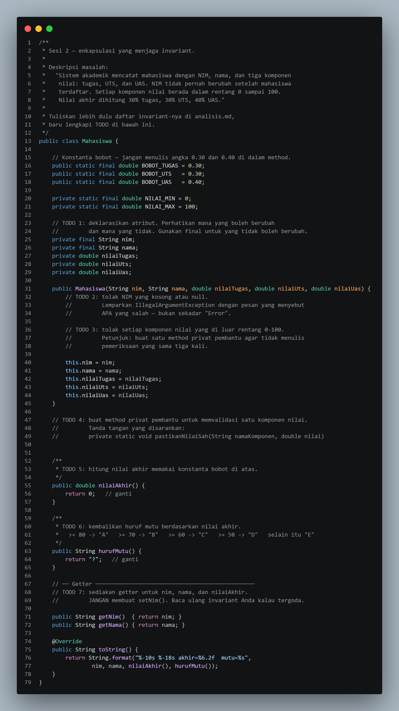
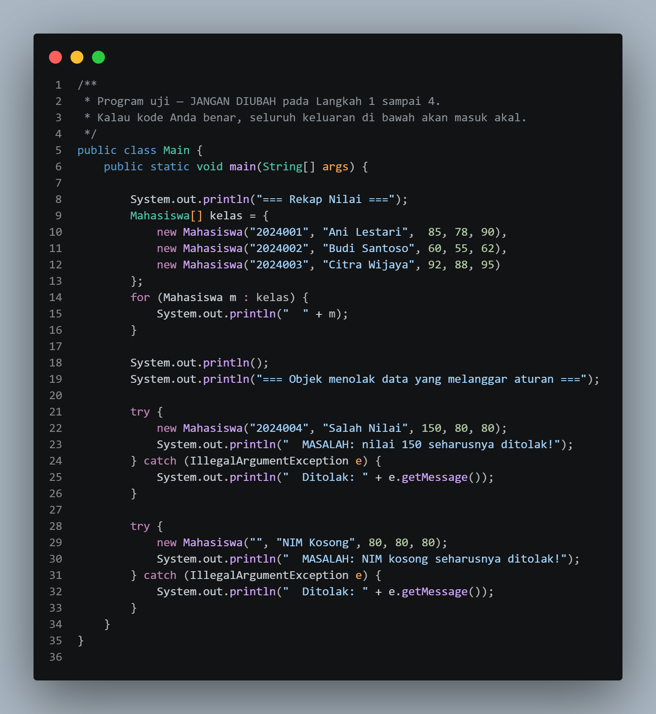
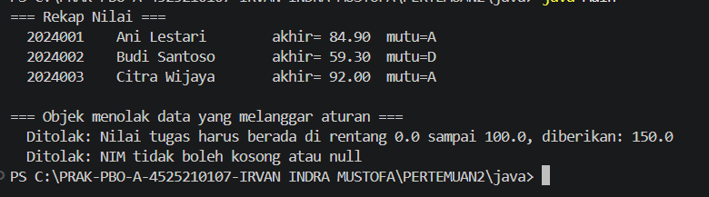
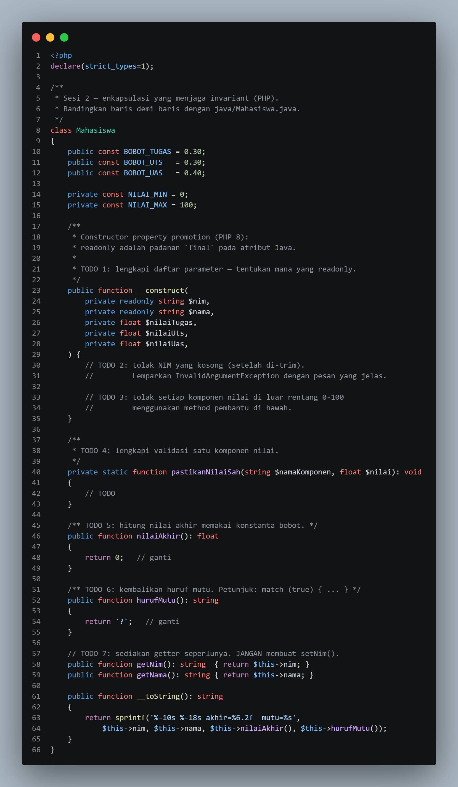
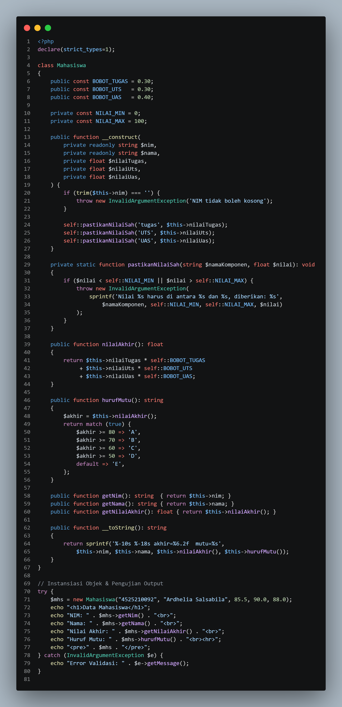
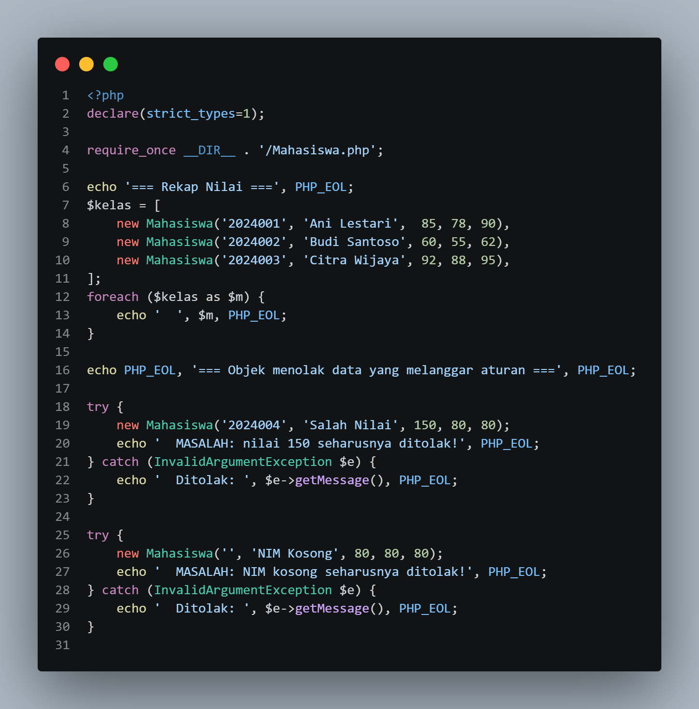
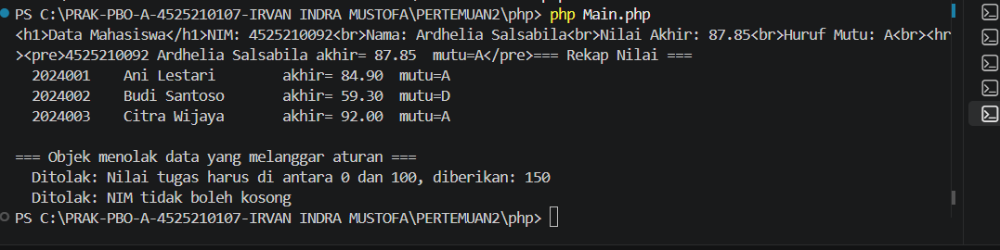

# LAPORAN PRAKTIKUM PEMROGRAMAN BERBASIS OBJEK

| Informasi Praktikan | Keterangan |
| :--- | :--- |
| **Nama** | Irvan Indra Mustofa |
| **NPM** | 4525210107 |
| **Kelas** | A |
| **Mata Kuliah** | Pemrograman Berbasis Objek (PBO) |
| **Pertemuan** | 02 - Enkapsulasi |
| **Tanggal** | 10-10-2026 |

---

## 1. Implementasi Java

### 1.1. File: `Mahasiswa.java`
**Penjelasan Kode:**
 Class `Mahasiswa` menerapkan enkapsulasi: seluruh properti bersifat `private`, `nim` dan `nama` dibuat `final` agar tidak berubah setelah objek terbentuk, dan tidak ada method `setNim()`. Constructor memvalidasi semua data sebelum disimpan. NIM ditolak jika `null` atau kosong (`nim == null || nim.trim().isEmpty()`) dan disimpan dalam bentuk yang sudah di-`trim()`. Setiap komponen nilai diperiksa oleh method pembantu `pastikanNilaiSah`, yang menolak nama komponen kosong, nilai `NaN`, nilai `Infinity`, serta nilai di luar rentang 0-100 dengan pesan kesalahan yang menyebut komponen dan nilai yang salah. Nilai akhir dihitung dengan konstanta bobot (30% tugas, 30% UTS, 40% UAS) di method `nilaiAkhir()`, lalu `hurufMutu()` mengubahnya menjadi huruf A sampai E dan melempar `IllegalStateException` bila nilai akhir tidak valid. Getter yang tersedia adalah `getNim()`, `getNama()`, dan `getNilaiAkhir()`.

**Bukti Eksekusi (Screenshot):**
* **Before** *(Kondisi awal / Kesalahan kompilasi)*:

* **After** *(Kondisi akhir / Eksekusi berhasil)*:

### 1.2. File: `Main.java`
**Penjelasan Kode:**
 `Main.java` adalah program utama yang memakai class `Mahasiswa`. Program membuat beberapa objek mahasiswa dengan data valid lalu mencetak rekap nilai akhir beserta huruf mutunya. Setelah itu program sengaja mencoba membuat objek dengan data yang melanggar aturan (misalnya nilai 150) di dalam blok `try-catch`, sehingga pesan penolakan dari constructor dapat ditampilkan tanpa program berhenti.

**Bukti Eksekusi (Screenshot):**`.

### Output
**Output Program:**

---

## 2. Implementasi PHP

### 2.1. File: `Mahasiswa.php`
**Penjelasan Kode:**
 Versi PHP dari class `Mahasiswa` dengan aturan yang sama seperti versi Java. Properti dibuat `private` dan hanya dapat diakses lewat getter. Constructor menolak NIM kosong dan nilai di luar rentang 0-100 dengan melempar `InvalidArgumentException`, sehingga objek yang melanggar aturan tidak pernah terbentuk. Nilai akhir dihitung dengan bobot 30% tugas, 30% UTS, dan 40% UAS, kemudian dikonversi menjadi huruf mutu.

**Bukti Eksekusi (Screenshot):**

* **After** *(Kondisi akhir / Eksekusi berhasil)*:

### 2.2. File: `Main.php`
**Penjelasan Kode:**
`Main.php` mengaktifkan `declare(strict_types=1)` lalu memuat class dengan `require_once __DIR__ . '/Mahasiswa.php'`, sehingga file tetap ditemukan dari folder mana pun program dijalankan. Program membuat tiga objek mahasiswa, menampilkan rekap nilainya dengan `foreach`, lalu mencoba membuat objek dengan nilai 150 di dalam blok `try-catch`. Pengecualian `InvalidArgumentException` ditangkap dan pesannya ditampilkan sebagai bukti bahwa objek menolak data yang melanggar aturan.

**Bukti Eksekusi (Screenshot):**

### Output
**Output Program:**

---

## 3. Kesimpulan
 Enkapsulasi membuat objek `Mahasiswa` mampu menjaga aturannya sendiri: properti `private`, `nim` dan `nama` yang `final` (pada Java), serta validasi di constructor memastikan tidak ada objek dengan data yang melanggar aturan. Perbaikan pada kode, yaitu membuang spasi pada NIM, menolak `NaN` dan `Infinity`, dan menambahkan pengaman pada `hurufMutu()`, membuat objek lebih tahan terhadap input yang tidak wajar. Praktikum ini juga menunjukkan bahwa kesalahan `file not found` pada kompilasi maupun eksekusi umumnya disebabkan oleh terminal yang berada di folder yang salah. Aturan (invariant) objek tetap terjaga sepanjang objek digunakan, baik pada implementasi Java maupun PHP.