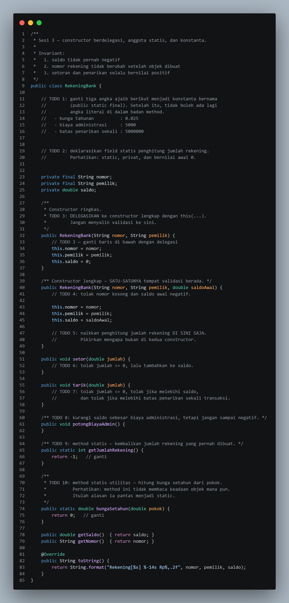
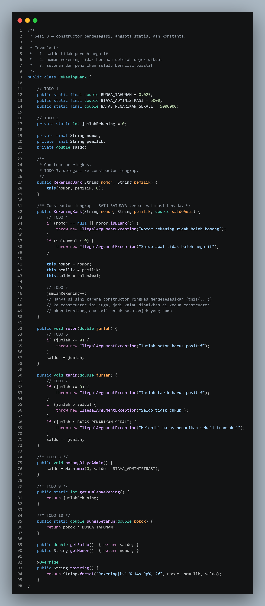
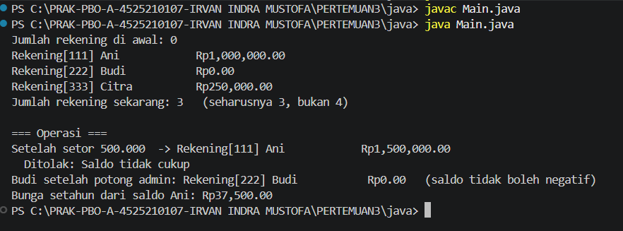
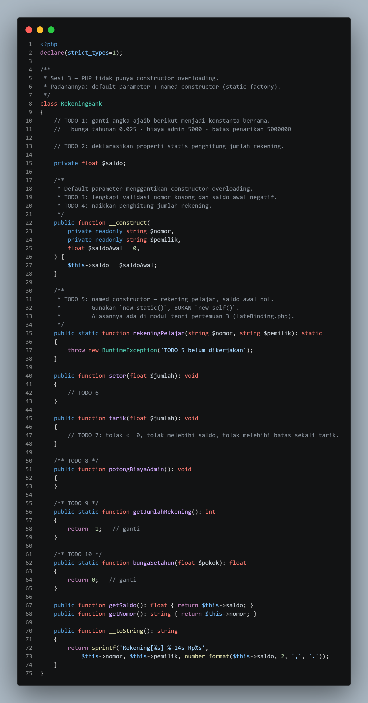
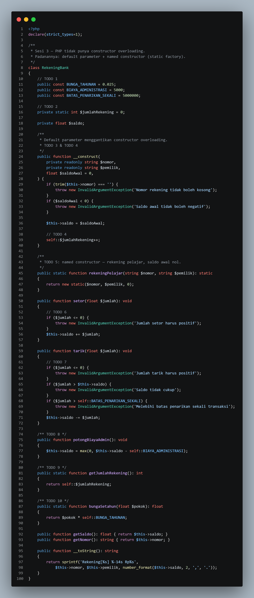
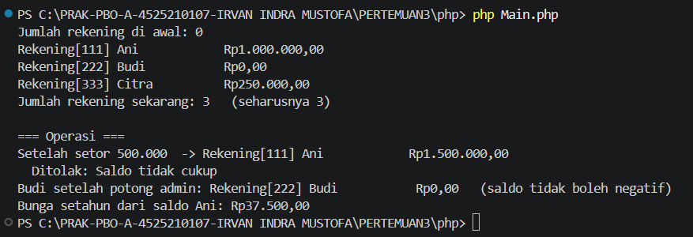

# LAPORAN PRAKTIKUM PEMROGRAMAN BERBASIS OBJEK

| Informasi Praktikan | Keterangan |
|---|---|
| **Nama** | Irvan Indra Mustofa |
| **NPM** | 4525210107 |
| **Kelas** | A |
| **Mata Kuliah** | Pemrograman Berbasis Objek (PBO) |
| **Pertemuan** | 03 - Kelas, Objek, dan Enkapsulasi |
| **Tanggal** | 10-10-2026 |

## 1. Implementasi Java

### 1.1 File RekeningBank.java

### Sebelum

Kode awal berupa kerangka class dengan 10 komentar `TODO`. Constructor ringkas masih menyalin isi sendiri, constructor lengkap belum divalidasi, `setor()`, `tarik()`, dan `potongBiayaAdmin()` masih kosong, serta `getJumlahRekening()` dan `bungaSetahun()` hanya mengembalikan nilai sementara.

### Sesudah

!

**Penjelasan:**

1. **Konstanta.** Angka ajaib diganti `BUNGA_TAHUNAN = 0.025`, `BIAYA_ADMINISTRASI = 5000`, dan `BATAS_PENARIKAN_SEKALI = 5000000` (`public static final`).
2. **Penghitung statis.** `private static int jumlahRekening` dimiliki class dan dipakai bersama semua objek.
3. **Constructor berdelegasi.** Constructor ringkas cukup memanggil `this(nomor, pemilik, 0)`, sehingga tidak ada kode yang diulang.
4. **Validasi satu tempat.** Constructor lengkap menolak nomor kosong dan saldo awal negatif. Penghitung dinaikkan di sini saja setelah validasi lolos, agar objek tidak terhitung dua kali.
5. **`setor()` dan `tarik()`.** `setor()` menolak jumlah `<= 0`. `tarik()` menolak jumlah `<= 0`, jumlah di atas saldo, dan jumlah di atas batas penarikan.
6. **`potongBiayaAdmin()`.** Memakai `Math.max(0, saldo - BIAYA_ADMINISTRASI)` agar saldo tidak negatif.
7. **Method statis.** `getJumlahRekening()` mengembalikan penghitung, dan `bungaSetahun(pokok)` mengembalikan `pokok * BUNGA_TAHUNAN`. Keduanya tidak memakai data objek, jadi cocok dibuat `static`.

### Output Java

## 2. Implementasi PHP

### 2.1 File RekeningBank.php

### Sebelum

Kerangka yang sama dalam PHP. Karena PHP tidak punya *constructor overloading*, constructor ringkas digantikan parameter default dan *named constructor*. Constructor belum divalidasi dan `rekeningPelajar()` masih melempar `RuntimeException`.

### Sesudah

**Penjelasan:**

1. **Konstanta dan properti statis.** `public const` untuk bunga, biaya admin, dan batas tarik (diakses dengan `self::`), serta `private static int $jumlahRekening` untuk penghitung.
2. **Pengganti overloading.** Parameter `float $saldoAwal = 0` membuat satu constructor bisa dipanggil dengan 2 atau 3 argumen.
3. **Validasi.** Constructor melempar `InvalidArgumentException` untuk nomor kosong dan saldo awal negatif. Properti `readonly` membuat `nomor` dan `pemilik` tidak bisa diubah. Penghitung dinaikkan setelah validasi lolos.
4. **Named constructor.** `rekeningPelajar()` memakai `new static(...)`, bukan `new self(...)`, sehingga objek yang dihasilkan mengikuti class pemanggil (*late static binding*).
5. **Operasi saldo.** `setor()`, `tarik()`, dan `potongBiayaAdmin()` memakai aturan yang sama seperti versi Java.
6. **Method statis.** `getJumlahRekening()` dan `bungaSetahun()` dibuat statis karena tidak memakai data objek.
7. **`__toString()`.** Saldo diformat dengan `number_format($this->saldo, 2, ',', '.')`.

### Output PHP

## Kesimpulan

1. Konstanta bernama menggantikan angka ajaib, sehingga aturan bisnis ada di satu tempat.
2. Constructor berdelegasi (`this(...)` di Java, parameter default di PHP) membuat validasi cukup ditulis sekali dan penghitung tidak terhitung ganda.
3. Anggota statis dimiliki class, cocok untuk data bersama dan fungsi yang tidak butuh data objek.
4. `new static()` pada PHP membuat *named constructor* menghasilkan objek dari class pemanggil.
5. Semua invariant terjaga: saldo tidak negatif, nomor rekening tidak dapat diubah, dan setoran serta penarikan selalu positif.
