# LAPORAN PRAKTIKUM PEMROGRAMAN BERBASIS OBJEK

| Informasi Praktikan | Keterangan |
| :--- | :--- |
| **Nama** | Irvan Indra Mustofa |
| **NPM** | 4525210107 |
| **Kelas** | A |
| **Mata Kuliah** | Pemrograman Berbasis Objek (PBO) |
| **Pertemuan** | 04 - Inheritance (Pewarisan) |
| **Tanggal** | Kamis 24 September 2026 |

---

## 1. Implementasi Java

### 1.1. File: `Main.java`

**Penjelasan Kode:**
> Membuat beberapa objek pegawai untuk menunjukkan bagaimana kelas induk dan kelas turunan menghasilkan perhitungan gaji yang berbeda.

**Bukti Eksekusi (Screenshot):**
- **Before** 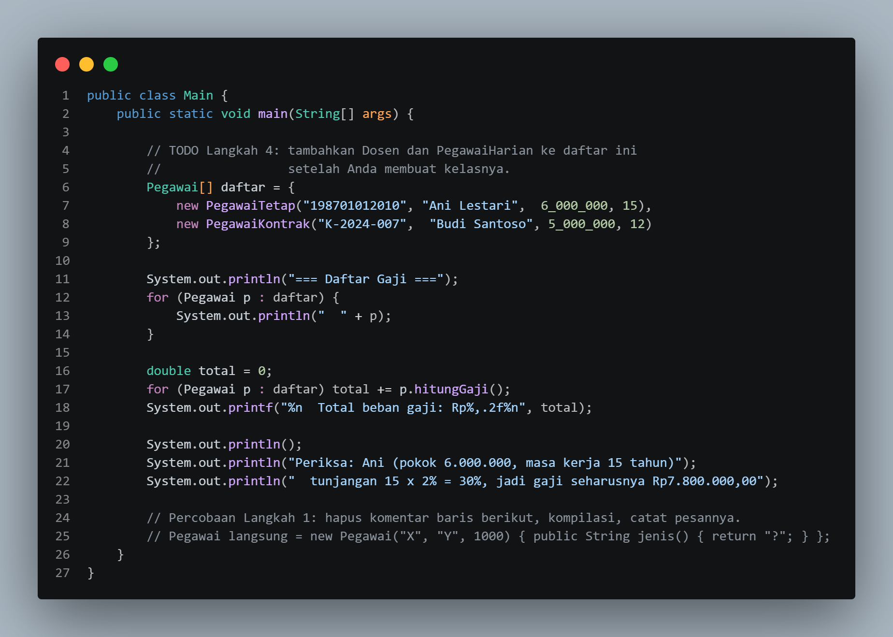

**After** 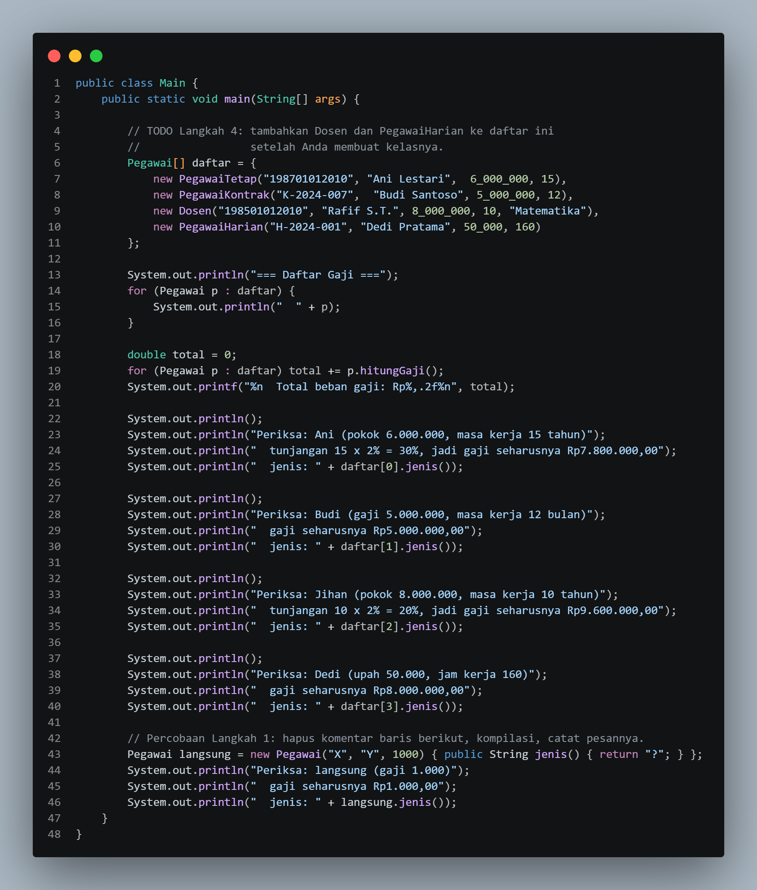

### 1.2. File: `Pegawai.java`

**Penjelasan Kode:**
> Kelas induk tempat data bersama seperti ID dan nama pegawai disimpan, beserta perilaku dasar yang dipakai ulang oleh kelas turunan tanpa perlu menulis ulang kodenya.

**Bukti Eksekusi (Screenshot):**
- **Before** 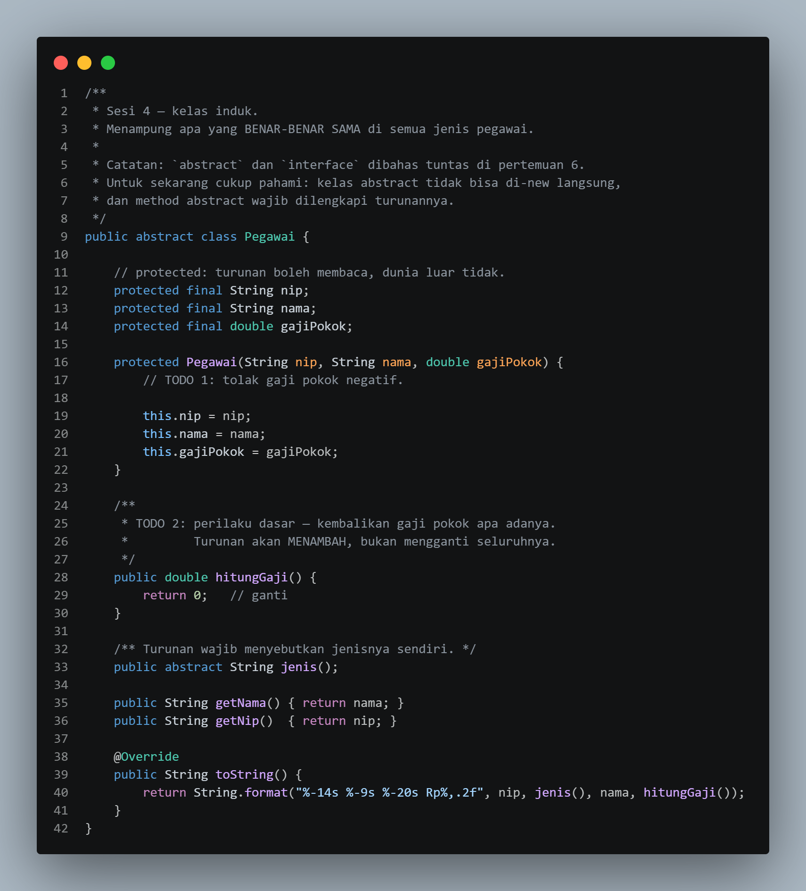
- **After** 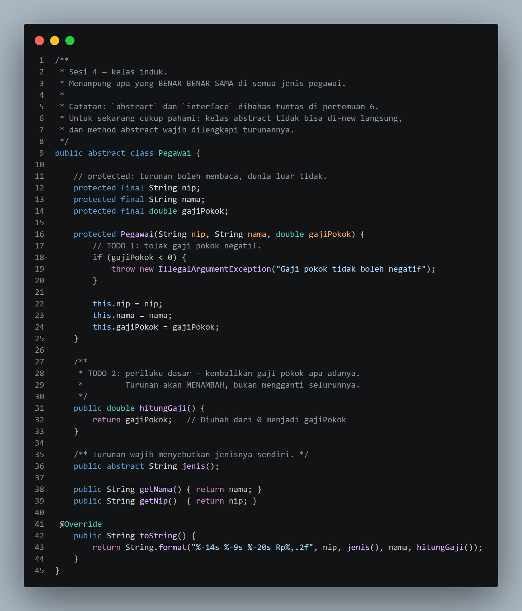

### 1.3. File: `PegawaiKontrak.java`

**Penjelasan Kode:**
> Kelas turunan dari `Pegawai` yang mewakili pegawai berstatus kontrak, dengan perilaku tambahan yang menyesuaikan ketentuan kontraknya.

**Bukti Eksekusi (Screenshot):**
- **Before** 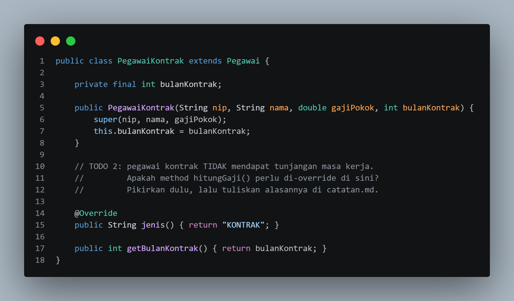
- **After** 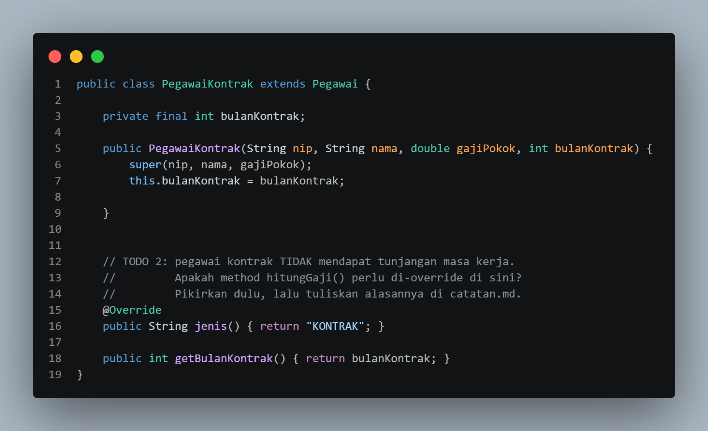

### 1.4. File: `PegawaiTetap.java`

**Penjelasan Kode:**
>Kelas turunan untuk pegawai tetap yang menerapkan perilaku khusus sesuai status kepegawaiannya.

**Bukti Eksekusi (Screenshot):**
- **Before** 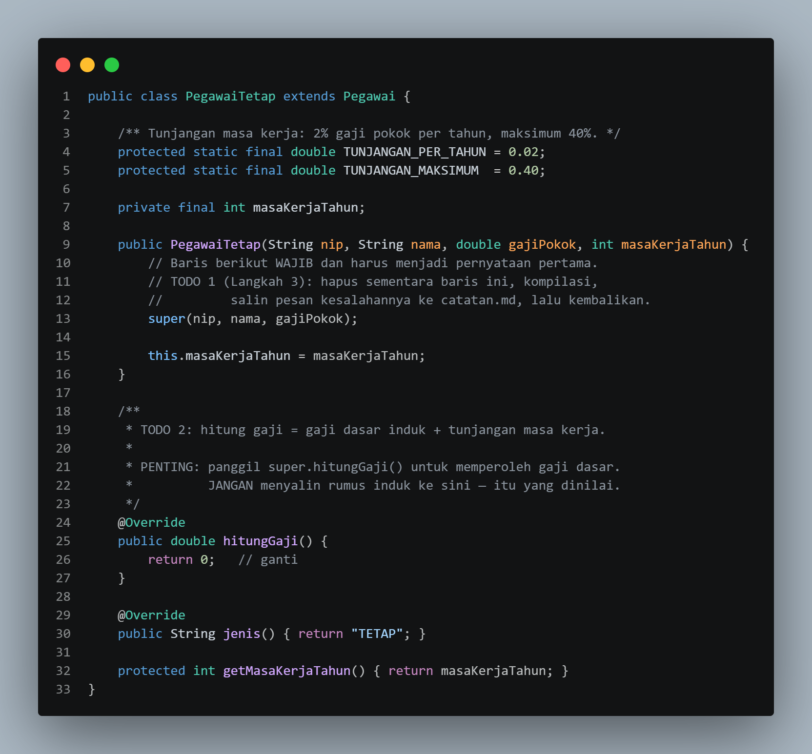
- **After** 

### Output

**Output Program:**
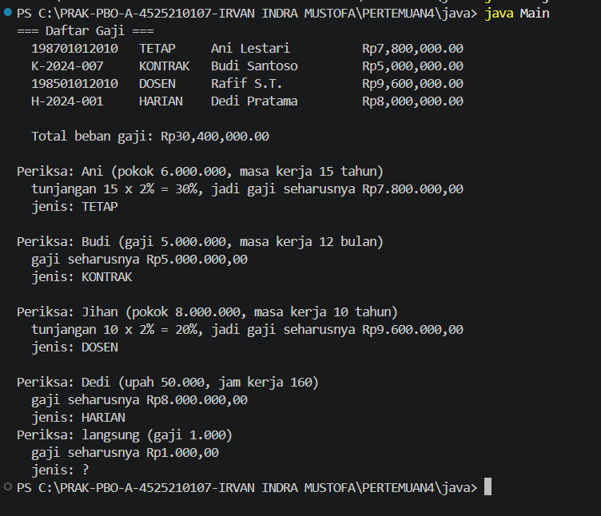

---

## 2. Implementasi PHP

### 2.1. File: `main.php`

**Penjelasan Kode:**
> Program PHP untuk membuat dan menggunakan objek pegawai melalui kelas dasar dan turunannya.

**Bukti Eksekusi (Screenshot):**
- **Before** 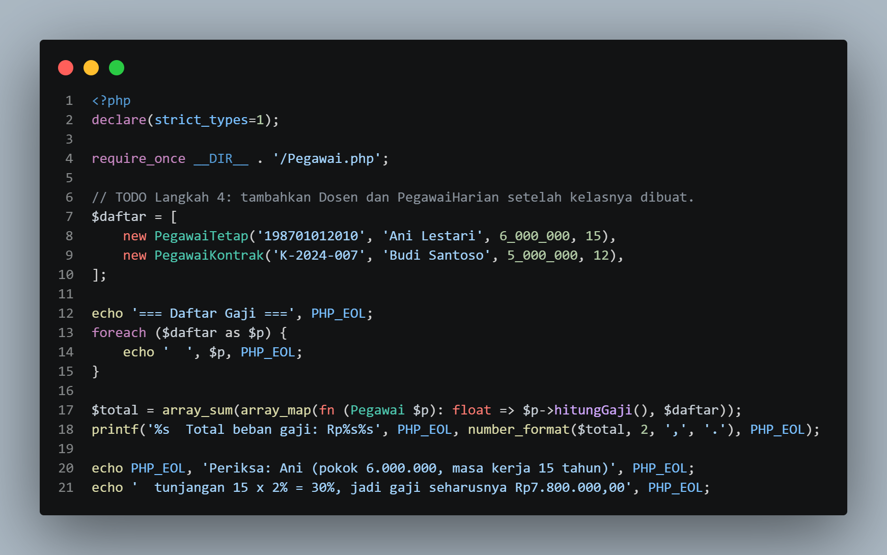
- **After** 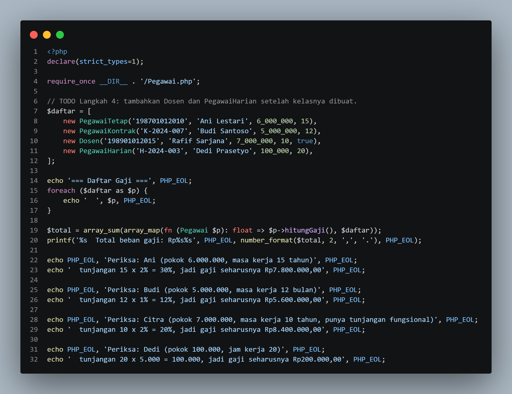

### 2.2. File: `Pegawai.php`

**Penjelasan Kode:**
>Program PHP yang membuat objek-objek pegawai berdasarkan kelas induk `Pegawai` dan kelas-kelas turunannya, lalu menjalankan perilaku masing-masing.

**Bukti Eksekusi (Screenshot):**
- **Before** 
- **After** 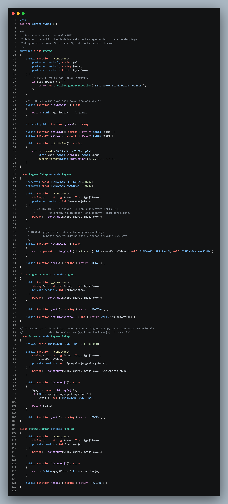

### Output

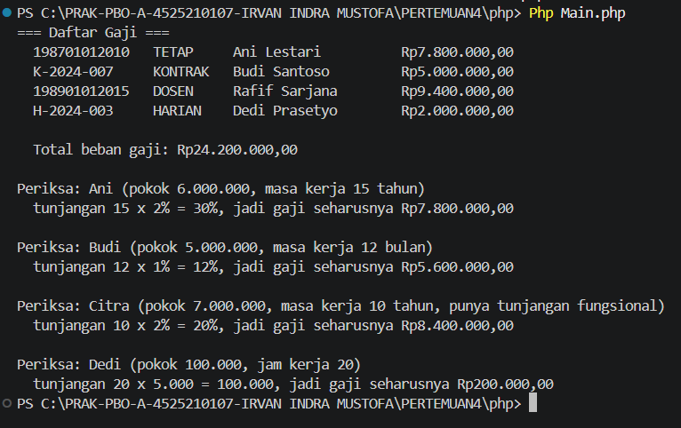

---

## 3. Kesimpulan

Inheritance memungkinkan kelas turunan memakai dan mengembangkan atribut serta method kelas induk. Pada pemodelan pegawai tetap dan kontrak, bagian yang sama ditaruh di kelas induk, sedangkan perilaku khusus ditaruh di kelas turunan.