# LAPORAN PRAKTIKUM PEMROGRAMAN BERBASIS OBJEK

| Informasi Praktikan | Keterangan |
| :--- | :--- |
| **Nama** | Irvan Indra Mustofa |
| **NPM** | 4525210107 |
| **Kelas** | A |
| **Mata Kuliah** | Pemrograman Berbasis Objek (PBO) |
| **Pertemuan** | 07 - Komposisi dan Agregasi |
| **Tanggal** | Kamis 15 Oktober 2026 |

---

## 1. Implementasi Java

### 1.1. File: `Main.java`

**Penjelasan Kode:**
> Pada praktikum ini, Main.java berfungsi sebagai program uji untuk memperlihatkan perbedaan Komposisi dan Agregasi pada Java. Di dalamnya, PerpustakaanService digunakan untuk mencoba pengelolaan koleksi buku, peminjaman, dan pengembalian secara sederhana.

**Bukti Eksekusi (Screenshot):**
- **Progam** 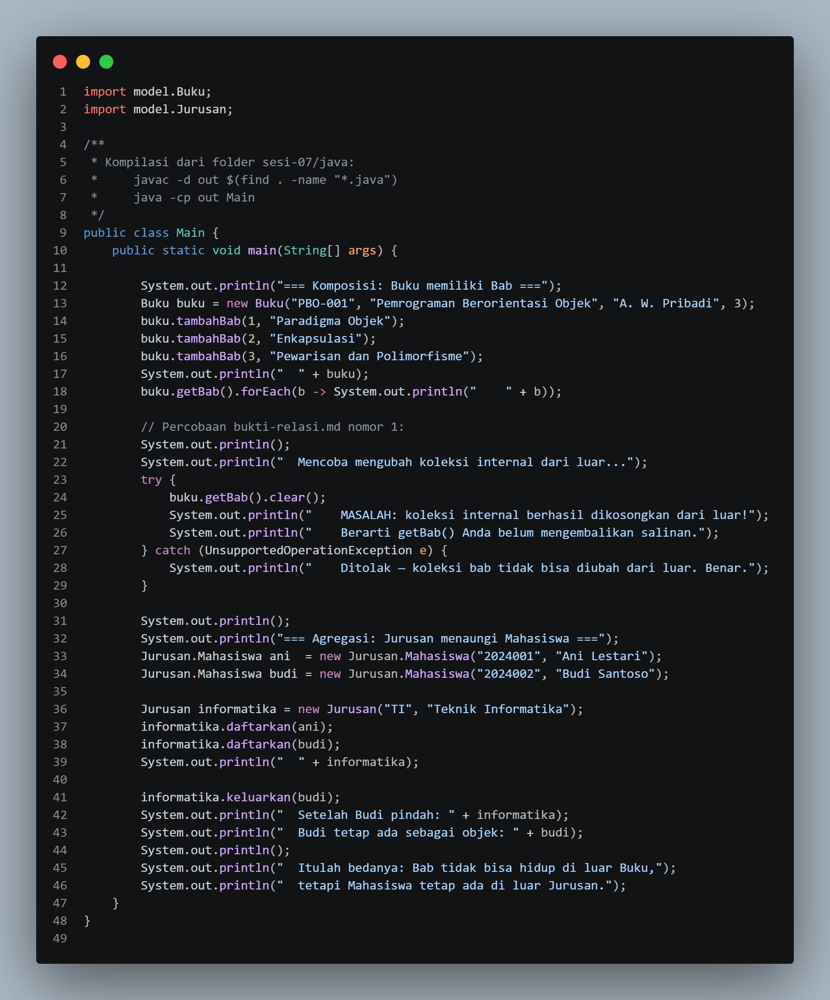

### 1.2. File: `Buku.java`

**Penjelasan Kode:**
> Pada Buku.java, objek Bab dibentuk dan diatur sepenuhnya oleh kelas Buku, sedangkan akses dari luar dibatasi dengan List.copyOf agar daftar bab tidak bisa diubah langsung. Kelas ini juga dilengkapi validasi stok buku sebagai bagian dari gambaran sistem perpustakaan.

**Bukti Eksekusi (Screenshot):**
- **Before** 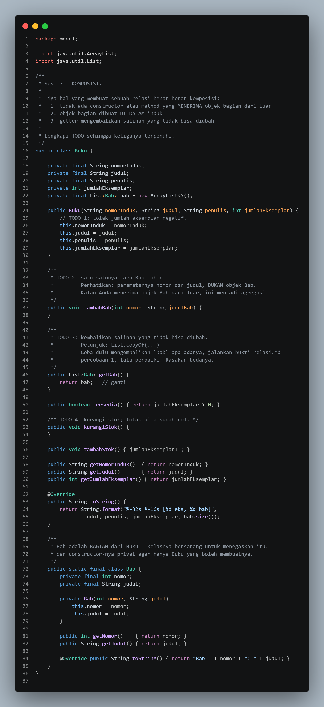
- **After** 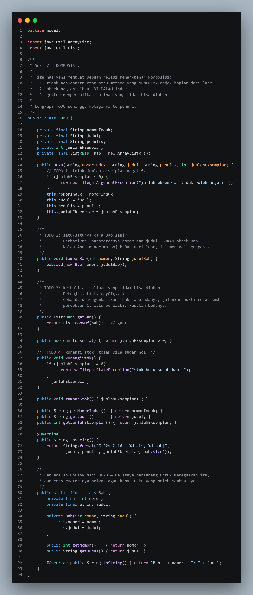

### 1.3. File: `Jurusan.java`

**Penjelasan Kode:**
> Jurusan.java mendemonstrasikan Agregasi: objek Mahasiswa berasal dari luar dan tetap hidup tanpa Jurusan, berbeda dengan Komposisi pada Buku, di mana Bab hanya ada selama Buku ada.

**Bukti Eksekusi (Screenshot):**
- **Before** 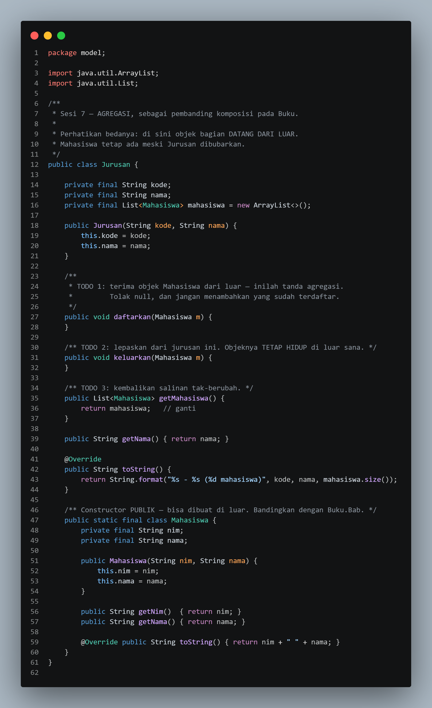
- **After** 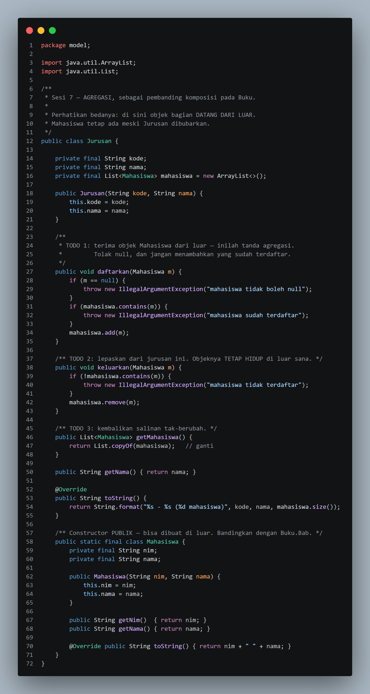

### 1.4. File: `PerpustakaanService.java`

**Penjelasan Kode:**
> PerpustakaanService.java adalah Service Layer yang mengelola inventaris koleksi dan mensimulasikan peminjaman buku, sekaligus menunjukkan Agregasi (menyimpan referensi Buku) sebagai pembanding Komposisi.

**Bukti Eksekusi (Screenshot):**
- **Before** 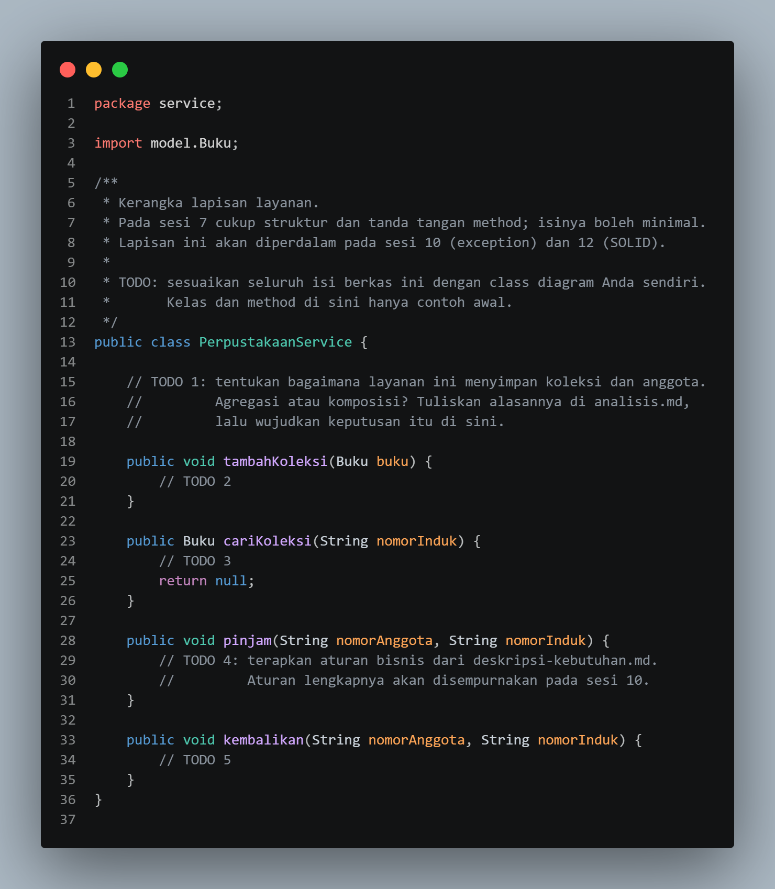
- **After** 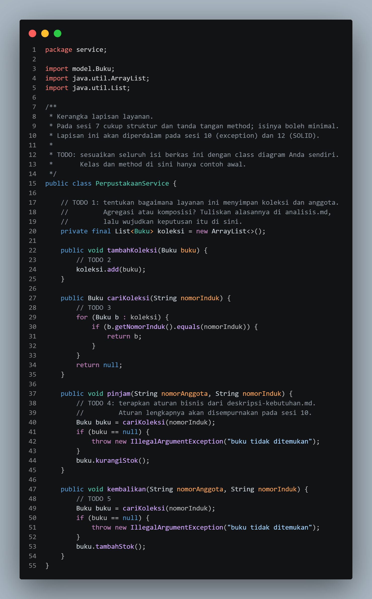

### Output

**Output Program:**

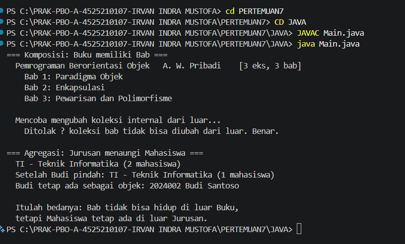

---

## 2. Implementasi PHP

### 2.1. File: `main.php`

**Penjelasan Kode:**
> Praktikum ini menerapkan konsep PBO dalam dua bahasa, yaitu Java dan PHP, untuk membandingkan Komposisi dan Agregasi. Di dalamnya, enkapsulasi koleksi diuji agar data tidak bisa diubah langsung dari luar, dan sebuah kerangka layanan perpustakaan dibuat untuk mengelola inventaris dan peminjaman buku.

**Bukti Eksekusi (Screenshot):**
- **Main** 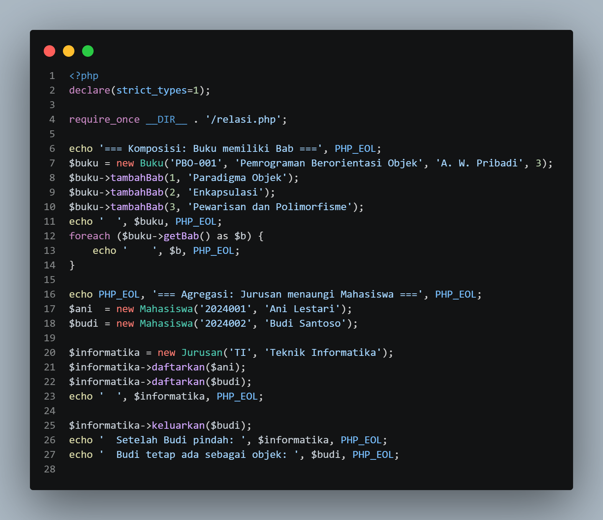

### 2.2. File: `relasi.php`

**Penjelasan Kode:**
> Praktikum ini berfokus pada perbedaan Komposisi dan Agregasi dalam PBO. Selain itu, enkapsulasi diuji dengan mengembalikan salinan koleksi agar data tidak bisa diubah dari luar, dan Service Layer dibuat sebagai kerangka pengelolaan inventaris dan transaksi perpustakaan.

**Bukti Eksekusi (Screenshot):**
- **Before** 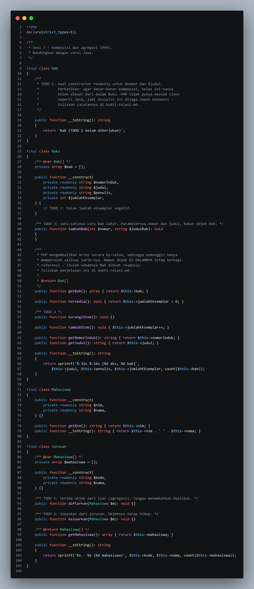
- **After** 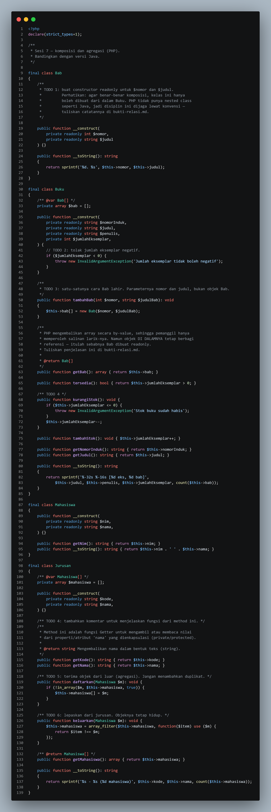
### Output

**Output Program:**

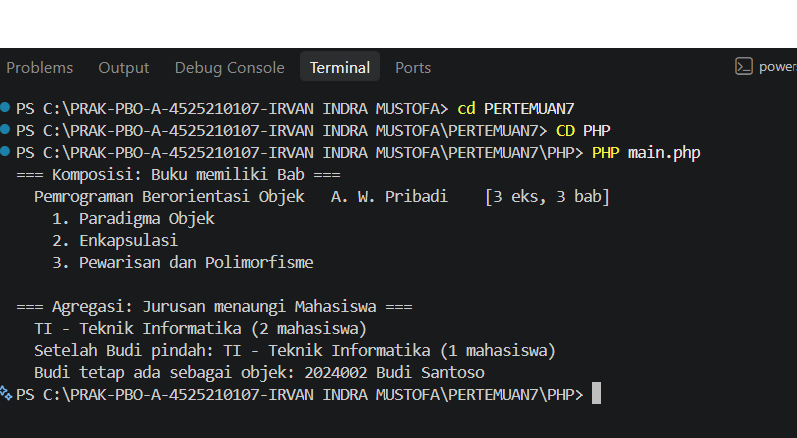

---

## 3. Kesimpulan

Komposisi dan agregasi adalah relasi antar-objek dalam PBO yang dibedakan oleh tingkat ketergantungannya. Pada komposisi, objek bagian (Bab) dibuat oleh dan bergantung penuh pada induknya (Buku), sehingga ikut hilang bersamanya. Pada agregasi, objek bagian (Mahasiswa) dibuat di luar dan tetap hidup mandiri meski dilepas dari penaungnya (Jurusan).